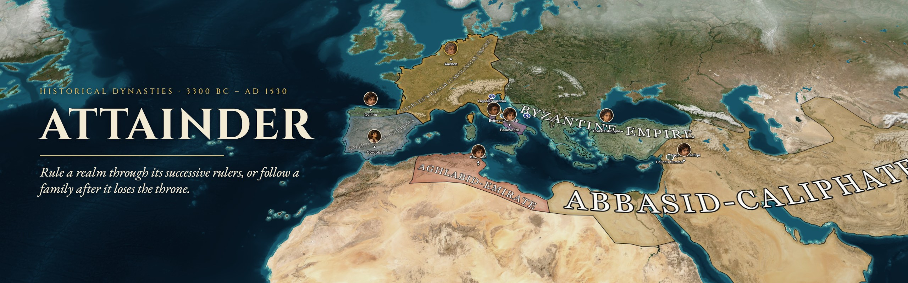
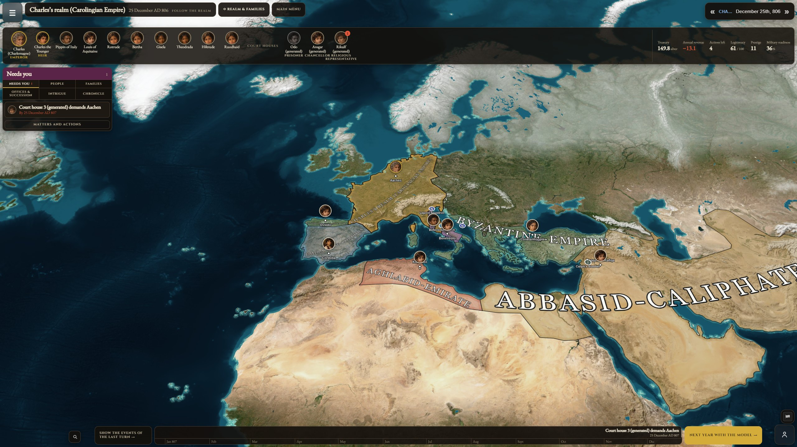

# Attainder

A strategy game of historical dynasties built on [Open Historia](https://github.com/Open-Historia/open-historia). Choose whether your campaign follows the state through successive rulers or a family that can survive losing power.

`main` offers four historical bookmarks: 25 December AD 800, the default, with ten playable realms from Charlemagne's to the Tang Empire; Egypt around 3000 BC; 31 December AD 1200 with John of England, France, the Almohads and the Khmer Empire; and 31 December AD 1500 with the Aztec and Inca empires. A new install reads English. Swedish is one press away on the start screen and under Options. The character system's source text is Swedish and reads in English through a phrase book. Public project documentation is in English.

The historical foundation implements the [historical-world direction](docs/superpowers/specs/2026-11-05-historical-world-direction.md): real geography and historical polities, with new starts from 3300 BC through AD 1530 and no modern starts. The [implementation plan](docs/superpowers/plans/2026-11-05-historical-campaign-foundation.md) is merged ([PR #13](https://github.com/sp1e/Attainder/pull/13)). The [play script](docs/play-scripts/historical-foundation.md) records the observed and pending checks. The [development backlog](docs/development/DEVELOPMENT-BACKLOG.md) retains the separate 4,830-year research and turn-end reference popup requirement.

The Egyptian court is generated; its mapped core is a selective approximation with uncertain southern control. John’s composite realms use approximate geometry and leave some control unresolved. The worldwide backdrop uses generalized modern land, not reconstructed ancient coastlines. [Sources, licenses and coverage](docs/research/historical-scenarios.md) explain these limits and distinguish documented identities from generated people.

## Play locally

Use Node.js 24, npm, and an installed, authenticated Codex CLI or Claude Code. The game uses the CLI's existing login. Model requests count toward that account's usage limits.

```sh
git clone https://github.com/sp1e/Attainder.git
cd Attainder
npm ci
node scripts/fetch-map-assets.mjs --ensure
npm run build
node scripts/launch-dynasties.mjs
```

`fetch-map-assets.mjs` downloads about 290 MB of map files from the upstream `map-data` release. Run it before the build, because the build copies them into `dist/`; without them the map requests return 404. The game finds Claude Code from a native install in `~/.local/bin`, from `PATH` or from an npm install.

On Windows, after the first build, double-click `Start-Attainder.cmd`. The launcher opens http://127.0.0.1:4167. Select Claude or Codex, then choose the state or family campaign mode. Expand the campaign seed control to set a starting seed. An empty field uses 104729. Seed 293 reproduces the starting conditions used in the smallpox gameplay check. Model narration can vary between runs.

Fresh clones store campaigns in `play-data/` and launcher logs in `reports/launcher/`. Both are ignored by Git. Set `ATTAINDER_DATA_HOME` to use another data directory. The older name `TIDES_DATA_HOME` still works. The original development installation retains its existing sibling data directory automatically.

Game ZIP exports include the available scenario map, including built-in maps, when it fits the size limit. If the map is missing, invalid or too large, the export reports its omission. Game-only imports keep their scenario reference unresolved until the matching map is restored, even when a local scenario has the same ID. A game-bound restore accepts a companion with usable map geometry or an identified map bundled with the installation. Older companions that relied on an unidentified stock-map fallback need a map source. The saved people and replay stay with the campaign.

## Character systems

- A ruler's archetype determines available abilities. Succession changes those abilities.
- Offices & inheritance shows a read-only succession forecast: expected actual ruler, lawful claims, ability changes, regency limits and project continuity. It describes a single ruler's death at today's date. Later events can change the result.
- A royal regent's authority and consent rules apply in both campaign modes. AI appointments and political stories use the acting adult's personality. A family guardian has a separate mandate. Blocked office promises can be deferred without payment.
- Severe illness can temporarily prevent an adult from exercising a mandate. Royal and household representatives act separately, and replacing a regent invalidates that person's consent. Recovery restores an unexpired personal ability without transferring the crown, family headship or property.
- Personality affects stress and changes how characters make decisions. Personal opinion, family support and religious affiliation remain separate.
- Memories connect decisions to later stories. Offices, family property, legal claims and actual political power can pass to different people.
- Eight recurring event types cover household pressure, education, temple donations, troubled cities, veterans, reconciliation, exile and returned favors. Participants and selection weights depend on the current campaign. Choices change resources, relationships and public administration; past support can return through a family successor.
- Illness, household infection, treatment, recovery and lasting scars follow the saved calendar. New care decisions can interrupt a longer time jump.
- OpenArt portraits follow each person's state. The 24 starting identities have 864 variants covering twelve conditions across three age groups.

The rules engine owns character outcomes. The model describes the world and can propose character actions. It cannot execute the player's decisions. Failed model generations do not silently become completed character turns.

Recurring decisions show why they appeared and when they expire. A longer turn stops at a new decision before the model narrates beyond it. If you continue without answering for twelve months, the stated free fallback applies. Events have participant and topic cooldowns to limit repetition.

## Free-text actions and odds

The labels in this section and the next are the ones an English install shows; with Swedish chosen the same controls carry their Swedish names.

In the `Overview` tab of the character panel, the card `Take action yourself` takes a sentence such as `I try to win Namar's support with gifts and flattery`. A low-effort model call maps the text to one action in the catalog. The engine then computes the odds, and a confirmation card shows them before anything is spent. `Choose from the list` opens every action as a menu, which also works when the model is disconnected or cannot read the text.

- Seven contested actions exist. Phase 1 added `Sway` (instant) and `Undermine` (a three-month scheme); Phase 2 added the five listed under Intrigue below. Command actions such as appointments stay in the same menu.
- Odds are integers from 5 to 95 for success and for secrecy, each with a list of labelled modifiers. How much of this the player sees depends on the actor's skill in the action: 12 or more shows the exact percentage, 7 to 11 shows one of five bands (`very low` to `very high`), and below 7 shows one of three (`unlikely`, `uncertain`, `likely`).
- Two rolls on a separate random stream pick one of five tiers: `Succeeded quietly`, `Succeeded but exposed`, `Failed quietly`, `Failed and exposed` and `It backfired`. The tier fixes the effects. A second low-effort model call writes the story and can move ranged effects inside their allowed range. If that call fails, the standard text stands.
- A scheme is paid at the start, checked monthly for discovery, and resolved on its due date. `Ongoing schemes` lists the family's schemes, and `Call off the scheme` asks for confirmation first.
- Difficulty is `Easy`, `Normal` or `Hard`, chosen on the start card or in the scenario picker. It moves the player's contested odds by +10, 0 or −10 percentage points, and in the opposite direction for NPC actions against the player's representative. Earlier campaigns count as `Normal`.
- Model proposals pass a gate. A `realm_effect` or `npc_intent` runs only through the engine's rules, with at most 4 and 3 per model turn, and a refused proposal is listed in the timeline. Replay never calls the model.
- The panel footer shows `Model requests this session`. The count lives in the open page and is not saved. It counts calls made through the local CLI only; calls through API-key providers are not counted.

The contract is in `src/runtime/characters/CONTRACT.md`. [The Phase 1 play script](docs/play-scripts/phase-1.md) walks through each feature in the running game.

## Intrigue

Phase 2 adds secrets, plots and prisoners on top of the Phase 1 action engine. All of it is rules code; the model reads your text and writes the story, and never decides an outcome.

- Five more contested actions: `Poison` (a one-month scheme that kills the target on success), `Snoop` (two months, reveals the target's strongest secret), `Blackmail` (instant, needs a secret you hold about the target), `Spread a rumour` (on a chosen topic) and `Imprison` (ruler only, 10 realm silver). `Poison` can also use a hook over the target.
- Secrets and hooks. A crime, an affair or a plot is a secret with a holder list and weak or strong evidence. A hook over a person makes your odds against that person better; a weak hook is spent when you use it, a strong one is not. The tab `Intrigue` lists the secrets you know, your hooks, the prisoners you hold, the rumors you have heard and your running schemes.
- The spymaster. The office `Spymaster` starts vacant and the realm never fills it; the ruler appoints it with `Appoint an office holder`. A spymaster hears more rumors about other houses' plans and adds to the monthly chance of seeing through a plan against your family.
- Feasts. `Hold a feast` costs 30 silver and one order, runs one month and can be held once a year. While it runs, intrigue actions against a guest gain 15 points of success chance and lose 5 points of secrecy chance, and the odds card lists both rows.
- Prisoners. A jailed person loses every office and cannot act. You can free (`Release`) or execute (`Execute`) a prisoner, or wait for the yearly step: the prisoner's family either offers a 40 silver ransom (`Ransom for …`, answered with `Accept the ransom` or `Reject the offer`) or prepares a revolt. When another family holds the crown and jails one of your kin, that family may demand the ransom from you (`Pay the ransom` or `Decline`). The ruler and the person who represents your family or the realm cannot be imprisoned.
- Rumors. The family hears about other houses' plans through a monthly check, and a rumor states its reliability as `uncertain`, `likely` or `certain`. A rumor you start with `Spread a rumour` is always false. Which rumors are true never reaches the screen or any model prompt.
- Plots against you. Each year, people outside your family may start an `Undermine` or `Poison` against your ruler or representative, and rival houses may feud with each other. The difficulty `Hard` raises their chance and `Easy` lowers it. A plot against you that is seen through opens the decision `Plot exposed: …` with four answers: `Imprison the plotter`, `Expose the plot`, `Keep the knowledge as a hook` and `Let it be`.
- Court conversations. The button `Talk` on a person in the `People` tab opens a conversation with a household member or an office holder. The model reads what you say and reports whether you ask for support, a secret or a pledge, with an offer of silver and the arguments you give. The engine checks that each argument is real, shows the odds, rolls once and fixes the answer before the person replies in character.
- Three random streams keep the draws apart: the main stream, the action stream (rolls and scheme checks) and the plot stream (NPC plots, rumor hearing, ransom offers). Estimates and presentations draw nothing, and replay never calls the model.

[The Phase 2 play script](docs/play-scripts/phase-2.md) walks through each feature in the running game. Known limits are listed in `docs/development/CONTINUE-HERE.md`.

## Court and power

A reign now has goals, prestige and earned nicknames. Legitimacy shows its sources. Council members serve according to loyalty you can only read as well as your spymaster can. Dread holds some nobles back and turns others into enemies. Sustained stress ends in a breakdown with a real cost. Great families demand cities and offices. Discontented nobles form hidden factions, and a strong faction sends a dated ultimatum: abdicate, concede, try to crush it, or lose the throne when the date comes. The engine decides every outcome, and the model sees the court only as far as you know it.

## The map and the court over it



In a historical campaign the map is the game's own MapLibre map with relief, a tilted camera, painted sea and lakes, snow that follows the date and the latitude, an outline around every realm, and each ruler's portrait at his seat ([design](docs/superpowers/specs/2026-11-13-living-map-design.md)).

On a desktop the court stands over that map ([design](docs/superpowers/specs/2026-11-15-court-shell-design.md)):

- a thread of portraits along the top, the ruling house in the order of succession and then the other houses at court, with the realm's six figures beside it;
- a panel on the left with six areas: what needs you, the people, the families, the offices and the succession, the intrigue and the chronicle. A matter unfolds there with its choices and is answered there;
- a card on the right for the person you select, with skills, opinion and goal, and the actions that name that person;
- a year line along the bottom with the deadlines of the twelve months ahead. The year turns from it, and the year's record is read over the map;
- a bar at the top with the realm's name, the date and the way to the main menu.

The full panel, with conversations, free-text actions, envoys and schemes, opens docked beside the map instead of over it. A phone keeps the earlier full-screen panel.

## Scenarios Are Released Under CC BY 4.0

The upstream scenario-sharing rules remain in place. Scenarios posted or shared through the game are released under [Creative Commons Attribution 4.0 International](https://creativecommons.org/licenses/by/4.0/). Exported scenario files include the corresponding license record. Separately referenced maps, music and other third-party material retain their own terms.

## Development status

As of 18 November 2026 `main` holds the historical starts, the character systems below, the living map and the court shell, and a new install reads English ([design](docs/superpowers/specs/2026-11-18-english-first-design.md)). The suite has 5,886 tests. A year written by the local model from the year line was measured on a copy of the Charlemagne campaign: of eight years turned on 16 and 18 November, five were written (about three to five minutes each) and three were refused by a check on the model's answer; each of the three now has its repair ([design](docs/superpowers/specs/2026-11-16-court-year-world-repairs-design.md)). The paragraphs below are the record of earlier checkpoints.

The historical branch remains in development. [PR #13](https://github.com/sp1e/Attainder/pull/13) tracks the branch and its merge state. At `2066a55`, [CI run 42102593161](https://github.com/sp1e/Attainder/actions/runs/42102593161) passed: 4,654 tests passed, none failed, two are TODOs, and the build passed. The controller accepted browser evidence for both bookmarks and adapters with the limits in the [play script](docs/play-scripts/historical-foundation.md). Final review approved publication subject to current-head CI. The latest full local lint measurement, before the final render fixes, reported 18 errors and 71 warnings, matching the earlier aggregate; the final globe-fix files passed targeted lint. Build warnings remain.

The Phase 3 annual accounting and legacy replay fixes passed branch review and the required CI check. [PR #12](https://github.com/sp1e/Attainder/pull/12) merged them as verified remote `main` commit `6f4f7c0de84ea58010e5ea597ff0325f572ea4eb`. The original Hadara browser script remains deferred; the Phase 0 theme and narrow-layout check remains open.

Phase 1 (free-text actions, odds, schemes, the model gate and the panel) and Phase 2 (intrigue) have automated tests and manual play scripts, [Phase 1](docs/play-scripts/phase-1.md) and [Phase 2](docs/play-scripts/phase-2.md); both passed against Claude Code on 4 November 2026, part by part, as recorded in `docs/development/CONTINUE-HERE.md`. Regent authority checks cover both campaign modes, appointment consent, independent family guardians, exact promise deadlines and saved-state validation. Recurring decisions were checked in an isolated browser fixture, including a submitted choice and its saved memory after a full page reload. Earlier production browser checks covered a real Codex year, smallpox, paid treatment and persistence after reopening. Claude was also tested through its existing CLI login.

The portrait component passed 864 rendered state/age combinations, including delayed and failed image loading. Its controls support light and dark themes and a narrow viewport.

Regent acceptance checks covered 48 combinations of campaign position, theme and viewport. In both state and family campaigns, appointing an official spent ten state silver and consumed one consent. A full page reload preserved the result without another transaction. These checks used isolated campaign fixtures.

Incapacity checks covered 28 combinations of seven scenarios, theme and viewport. Private recovery spent ten family silver. Public religious support spent twenty state silver. Each submitted choice persisted once, and a page reload produced no further writes. Calendar tests also covered a birthday, recovery and multiple deaths on the same date. No live model turn was used in these checks.

Known map limits include a straight Antarctic globe shading seam and a small blue gap near the pole, an oversized clipped polity label at the close Windsor view, and possible modern metadata baked into some translucent basemaps. The seam and gap are deferred visual defects; their cause is unconfirmed. No modern stock-label leak was established in the inspected views.

Known limits: aging uses three visual stages. New characters share a stable family illustration. Simultaneous conditions use a primary portrait state. One child series conveys illness through expression and complexion without skin lesions. The event library currently has eight recurring templates alongside the existing political and health stories. Unborn heirs, foreign family branches and broader AI action coverage need further development. These checks do not establish long-term balance or complete parity with Crusader Kings III or Old World.

```sh
node --test --test-concurrency=1 "server/**/*.test.js" "src/**/*.test.js"
npm run build
```

Read the [research and system design report](research.html) for the original CK3/Old World analysis and design proposals. This self-contained HTML report is in Swedish and preserves the research snapshot from 30 October 2026; its implementation-status statements are historical. Download it and open it in a browser to use the chapter navigation and light/dark themes.

See [the original documentation](UPSTREAM-README.md) for upstream features and [artwork provenance](public/dynasties/ARTWORK.md) for generated assets. Historical research and design notes are under `docs/research/` and `docs/design/`; some inherited working notes are in Swedish.

## License and attribution

The code retains Open Historia's AGPL-3.0-or-later license and copyright notices. See [LICENSE](LICENSE). Attainder is an independent derivative project. Generated artwork is documented separately and remains subject to the applicable provider terms.
